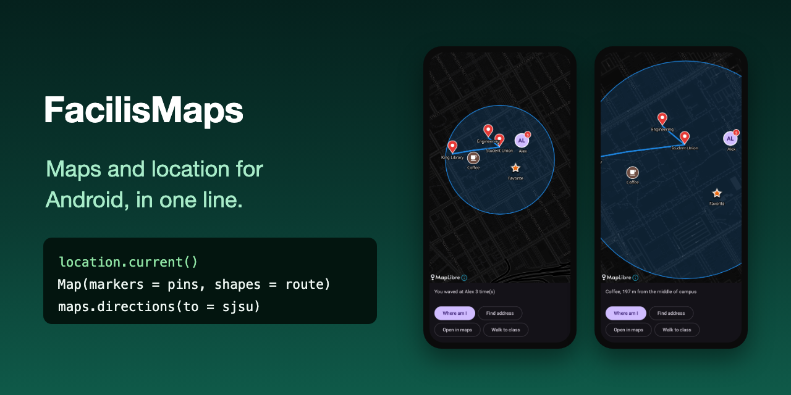

# FacilisMaps

[](https://jitpack.io/#al3j4ndrolm/FacilisMaps)
[](https://github.com/al3j4ndrolm/FacilisMaps/actions/workflows/build.yml)
[](LICENSE)

**Maps and location for Android in one line.** No API key, no billing account, no lifecycle code, no manifest edits.

<p align="center">
  
</p>

Part of the Facilis family, with [FacilisCam](https://github.com/al3j4ndrolm/FacilisCam), [FacilisStorage](https://github.com/al3j4ndrolm/FacilisStorage), [FacilisPermission](https://github.com/al3j4ndrolm/FacilisPermission), [FacilisNotification](https://github.com/al3j4ndrolm/FacilisNotification) and [FacilisAI](https://github.com/al3j4ndrolm/FacilisAI).

```kotlin
val here = location.current()                  // asks for permission itself

Map(center = here, markers = listOf(Marker(sjsu, "Class")))

maps.directions(to = sjsu, by = Travel.Walking)
```

Maps come from [MapLibre](https://maplibre.org) with free [OpenFreeMap](https://openfreemap.org) tiles, so there's nothing to sign up for.

## Where am I

```kotlin
val here = location.current()                  // null if denied, location off, or no fix
val quick = location.last()                    // instant, may be a few minutes old
location.watch().collect { point -> }          // live updates while you collect

here.distanceTo(sjsu)                          // 1.2 km
```

Every call asks for the location permission the first time (precise or approximate, the user picks). `location.allowed` tells you without asking. No coroutines? `location.current { here -> }`.

## Addresses

```kotlin
location.address(here)                         // "1 Washington Sq, San Jose, CA 95192, USA"
location.find("1 Washington Sq, San Jose")     // 37.336079, -121.880454
```

## Open a maps app

```kotlin
maps.open(sjsu, label = "Class")               // a pin in the user's maps app
maps.open("Blue Bottle Coffee, San Jose")      // a search
maps.directions(to = sjsu, by = Travel.Walking) // Driving, Walking, Transit, Biking
```

No SDK involved: these open Google Maps or whatever map app the user has.

## A map in your screen

```kotlin
Map(
    modifier = Modifier.fillMaxSize(),
    markers = listOf(Marker(sjsu, "MQH 225", data = "room-225")),
    showMyLocation = true,
    onMarkerTap = { marker -> openRoom(marker.data) },
    onLongPress = { point -> addPin(point) },
)
```

Leave `center` out and the map fits all your markers and shapes. Set it (and `zoom`, 0 = world, 15 = neighborhood) to move the map; it animates there whenever the value changes. Light or dark follows the system, or pass `style = MapStyle.Dark`. `onTap` and `onMoved` (the new center, each time the map stops) are there too.

Views? Same thing, with the lifecycle handled for you:

```xml
<io.github.al3j4ndrolm.facilis.maps.MapView
    android:id="@+id/map"
    android:layout_width="match_parent"
    android:layout_height="match_parent" />
```

```kotlin
map.show(center = sjsu, markers = listOf(Marker(sjsu, "Class")))
map.onMarkerTap = { marker -> }
map.fit()                                      // zoom to show everything
```

## Markers

```kotlin
Marker(sjsu, "Class")                                     // red pin
Marker(sjsu, "Class", color = 0xFF43A047.toInt())         // any color
Marker(cafe, "Coffee", icon = R.drawable.ic_cafe)         // your drawable, 36 dp
```

Or draw one with Compose. It's drawn into an image once (so hundreds of markers stay fast) and again whenever one of its keys changes:

```kotlin
val alex = rememberMarkerIcon(unread) { Avatar("AL", unread, Modifier.size(48.dp)) }
Map(markers = listOf(Marker(alexSpot, "Alex", icon = alex)))
```

## Lines and circles

```kotlin
Map(shapes = listOf(
    Line(listOf(library, union, mqh)),                    // straight segments, in order
    Circle(sjsu, radius = 400.meters),                    // "within 400 m"
))
```

Draw your walk as you go:

```kotlin
var trail by remember { mutableStateOf(listOf<Point>()) }
LaunchedEffect(Unit) {
    location.watch().collect { here ->
        if (trail.isEmpty() || trail.last().distanceTo(here) > 5.meters) trail = trail + here
    }
}
Map(showMyLocation = true, shapes = listOf(Line(trail)))
```

## Install

Add JitPack to `settings.gradle.kts`:

```kotlin
dependencyResolutionManagement {
    repositories {
        google()
        mavenCentral()
        maven("https://jitpack.io")
    }
}
```

Then add one dependency (min SDK 26):

```kotlin
// Compose apps: Map(...) and rememberMarkerIcon, plus everything else
implementation("com.github.al3j4ndrolm.FacilisMaps:maps-compose:1.0.0")

// Views apps
implementation("com.github.al3j4ndrolm.FacilisMaps:maps:1.0.0")
```

No manifest changes: the internet and location permissions are merged in for you.

## Good to know

- **Map tiles:** OpenFreeMap is free and needs no key, but it's run by volunteers. To use another provider, set `maps.lightStyle` and `maps.darkStyle` to its style URLs once, in `Application.onCreate`. Keep the map's attribution button visible; OpenStreetMap's license requires it.
- **Location:** uses Google Play services when the phone has it, and the phone's own GPS otherwise. Updates come while your app is open; background tracking isn't included.
- **Addresses** use Android's built-in geocoder, which needs a network connection.
- **Lines** are straight between your points. Routes along roads need a routing service and aren't included; `maps.directions` hands that to the user's maps app.
- **App size:** MapLibre's native code adds about 10 MB per CPU type. Play Store bundles download only the one each phone needs.

## Contributing

```bash
./gradlew :maps:testDebugUnitTest :maps:assembleRelease :maps-compose:assembleRelease :sample:assembleDebug
```

`maps/` is the library (location, maps apps, `MapView`), `maps-compose/` the Compose `Map` and `rememberMarkerIcon`, and `sample/` a demo app.

## License

[MIT](LICENSE). Maps © [OpenStreetMap](https://www.openstreetmap.org/copyright) contributors, served by [OpenFreeMap](https://openfreemap.org).
